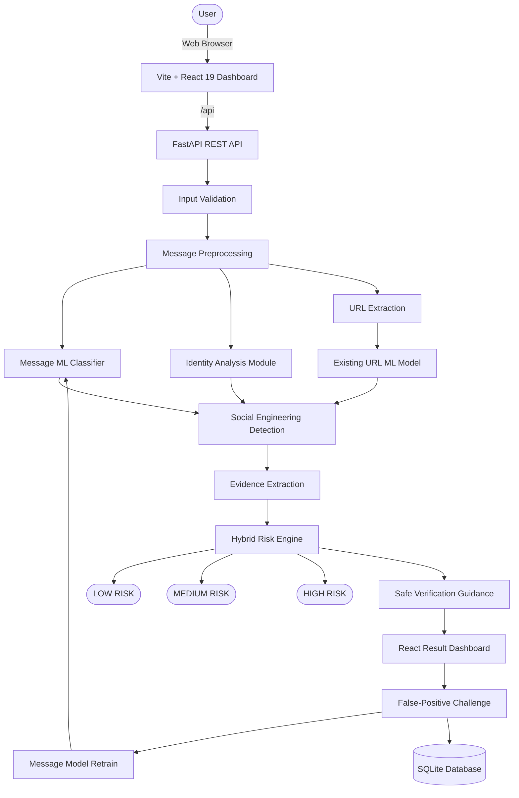

# TRUSTLENS — AI/ML-Based Phishing, Identity Impersonation & Social Engineering Detection

[](https://www.python.org/)
[](https://fastapi.tiangolo.com/)
[](https://react.dev/)
[](https://scikit-learn.org/)
[](https://vite.dev/)
[](LICENSE)

TRUSTLENS is a comprehensive cybersecurity intelligence platform that detects **phishing URLs**, **suspicious emails**, **SMS messages**, **identity impersonation** and **social-engineering attacks** using traditional machine learning and deterministic security rules.

Built with an **Airgap Safe-Mode** architecture: TRUSTLENS **never** connects to target URLs, performs zero DNS resolutions, sends no outbound requests and executes no remote scripts — eliminating all secondary infection risks during threat triage.

> **Evolution:** TRUSTLENS extends the original AegisThreat phishing URL detection system. All original URL detection functionality is fully preserved.

---

## Table of Contents

- [What TRUSTLENS Detects](#what-trustlens-detects)
- [System Architecture](#system-architecture)
- [Key Features](#key-features)
- [Quick Start Guide](#quick-start-guide)
- [API Reference](#api-reference)
- [URL Detection — 24 Feature Vectors](#url-detection--24-feature-vectors)
- [Machine Learning Models](#machine-learning-models)
- [Dataset Sources](#dataset-sources)
- [Automated Testing](#automated-testing)
- [Project Directory Structure](#project-directory-structure)
- [Security Disclaimer & License](#security-disclaimer--license)

---

## What TRUSTLENS Detects

| Threat Category | Channel | Details |
| :--- | :---: | :--- |
| **Phishing URLs** | URL | ML-powered static analysis with 24 lexical features |
| **Suspicious email content** | Email | ML classification + keyword analysis |
| **Suspicious SMS content** | SMS | ML classification + keyword analysis |
| **Sender identity inconsistencies** | Email | Display name vs. claimed org mismatch |
| **Domain impersonation** | Email | Lookalike/typosquat detection via Levenshtein distance |
| **Reply-To mismatches** | Email | Cross-domain reply-to indicator |
| **Urgency & pressure language** | Both | Pattern-matched manipulation signals |
| **Fear-based threats** | Both | Account suspension, legal threats |
| **Credential harvesting** | Both | OTP, password, PIN, card number requests |
| **Financial manipulation** | Both | Payment, transfer, fee demands |
| **Impersonation language** | Both | Authority-based social engineering |
| **URL shortener obfuscation** | Both | bit.ly, tinyurl, t.co detection in messages |
| **Punycode / IDN homographs** | Email | xn-- encoded domain detection |

**Languages supported:** English · Hindi · Kannada · Indic-English code-mixed

---

## System Architecture



---

## Key Features

### Message Analysis (NEW in v2.0)
- **Email & SMS analysis** with separate input forms and tailored checks
- **ML message classifier** trained on phishing email, Hindi, Kannada SMS and UCI SMS datasets
- **Identity trust assessment** — sender name consistency, reply-to mismatch, domain lookalike and punycode detection
- **Social engineering signal detection** — urgency, fear, credential harvesting, financial manipulation and impersonation patterns in English, Hindi and Kannada
- **Evidence extraction** — every finding includes the exact text excerpt and an explanation
- **Hybrid risk engine** — combines ML score, identity signals, URL analysis and SE patterns into HIGH / MEDIUM / LOW risk
- **Safe verification recommendations** — always includes “verify through a known official channel” guidance
- **False-positive challenge** — users can mark a result as legitimate; the sample is used to retrain the classifier so re-analysis reflects the correction
- **Privacy by design** — message text is stored for retraining only when the user submits a challenge

### URL Detection (Original, preserved)
- **Airgap Safe-Mode Static Inspection** — zero HTTP requests, zero DNS lookups
- **24-vector lexical and entropy feature extractor** — Shannon entropy, symbol density, subdomain depth, brand typosquatting and more
- **High-recall Random Forest classifier** — 100% recall on evaluation holdout
- **Batch scanner** — up to 50 URLs per request
- **Interactive SOC dashboard** — risk gauges, feature heatmap, vulnerability matrix and audit trail

---

## Quick Start Guide

### Prerequisites

- **Python** 3.10+ (3.11, 3.12 or 3.14)
- **Node.js** 18+ (with npm or pnpm)
- **Git**

### Environment Setup

```bash
# 1. Clone the repository
git clone https://github.com/<YOUR_USERNAME>/Phishing-URL-Detection.git
cd Phishing-URL-Detection

# 2. Create .env from the template
copy backend\.env.example backend\.env   # Windows
# cp backend/.env.example backend/.env   # Linux / macOS
```

Review `backend/.env`:
```env
ENVIRONMENT=development
PROJECT_NAME="TRUSTLENS - Phishing & Social Engineering Detection"
DATABASE_URL=sqlite:///./scans.db
BACKEND_CORS_ORIGINS=["http://localhost:5173","http://127.0.0.1:5173"]
```

### Option 1: One-Click Launch (Windows)

```cmd
start_all.bat
```

### Option 2: Manual Launch

**Backend:**
```bash
cd backend

# Create and activate virtual environment
python -m venv ../venv
# Windows:
..\venv\Scripts\activate
# Linux / macOS:
# source ../venv/bin/activate

pip install -r requirements.txt
uvicorn app.main:app --host 127.0.0.1 --port 8000 --reload
```

**Frontend:**
```bash
cd frontend
npm install
npm run dev
```

Open `http://localhost:5173` in your browser.

- Swagger API docs: `http://127.0.0.1:8000/docs`
- Health check: `http://127.0.0.1:8000/api/health`

---

## API Reference

### Existing URL Endpoints (preserved)

| Method | Endpoint | Description |
| :--- | :--- | :--- |
| `GET` | `/` | API status |
| `GET` | `/api/health` | Health check, model readiness, DB state |
| `POST`| `/api/predict` | Single URL static analysis |
| `POST`| `/api/batch-predict` | Batch URL analysis (up to 50) |
| `GET` | `/api/model-info` | Classifier metrics and feature importances |
| `GET` | `/api/history` | Scan audit log |

### New Message Analysis Endpoints (v2.0)

| Method | Endpoint | Description |
| :--- | :--- | :--- |
| `POST`| `/api/analyze-message` | Email message analysis |
| `POST`| `/api/analyze-sms` | SMS message analysis |
| `POST`| `/api/feedback` | Submit false-positive/negative feedback |
| `GET` | `/api/feedback/summary` | Retrieve feedback summary |

### Email Analysis Request Example

```bash
curl -X POST "http://127.0.0.1:8000/api/analyze-message" \
     -H "Content-Type: application/json" \
     -d '{
       "sender_name": "Demo Bank Security",
       "sender_email": "security@dem0bank.com",
       "reply_to": "collect@gmail.com",
       "claimed_org": "Demo Bank",
       "subject": "URGENT: Verify your account",
       "message": "Your account has been suspended. Click http://dem0bank-verify.tk/login to verify your password and OTP immediately.",
       "language": "english"
     }'
```

### SMS Analysis Request Example

```bash
curl -X POST "http://127.0.0.1:8000/api/analyze-sms" \
     -H "Content-Type: application/json" \
     -d '{
       "sender_id": "+919876543210",
       "claimed_org": "Demo Bank",
       "message": "URGENT: Your Demo Bank account will be blocked! Click http://dem0bank.tk/verify now. Enter OTP immediately.",
       "language": "english"
     }'
```

---

## URL Detection — 24 Feature Vectors

| # | Vector | Threat Rationale |
| :-: | :--- | :--- |
| 1 | `url_length` | Long URLs obscure malicious targets |
| 2 | `hostname_length` | Oversized hostnames impersonate enterprise domains |
| 3 | `path_length` | Deep paths mimic legitimate directory structures |
| 4 | `query_length` | Payload injection via query parameters |
| 5 | `num_dots` | Complex subdomain spoofing |
| 6 | `num_hyphens` | Brand name stitching (`apple-id-login`) |
| 7 | `num_underscores` | Credential harvesting script indicator |
| 8 | `num_slashes` | Path traversal mimicry |
| 9 | `num_question_marks` | Query manipulation |
| 10 | `num_equal_signs` | Telemetry tracking parameters |
| 11 | `num_at_symbols` | HTTP authority disguise (`victim@malicious.com`) |
| 12 | `num_digits` | Dynamic disposable campaign indicator |
| 13 | `digit_ratio` | Numeric concentration measure |
| 14 | `num_subdomains` | Multi-level subdomain chain mimicry |
| 15 | `is_ip_address` | Direct IP bypasses DNS registration |
| 16 | `is_https` | Plaintext HTTP flags missing encryption |
| 17 | `has_suspicious_keywords` | Credential keyword detection |
| 18 | `is_shortened` | URL shortener obfuscation |
| 19 | `suspicious_tld` | High-abuse TLD detection |
| 20 | `url_entropy` | Shannon entropy for randomness detection |
| 21 | `has_digit_substitution` | Leetspeak spoofing (`paypa1`, `g00gle`) |
| 22 | `brand_doppelganger` | Levenshtein typosquatting distance |
| 23 | `has_punycode_idn` | IDN homoglyph attack detection |
| 24 | `path_has_brand_mismatch` | Brand token in path hosted elsewhere |

---

## Machine Learning Models

### URL Classification Model (Original)

| Classifier | Accuracy | Precision | Recall | F1 | AUC |
| :--- | :---: | :---: | :---: | :---: | :---: |
| **Random Forest (Selected)** | **100.0%** | **100.0%** | **100.0%** | **1.000** | **1.000** |
| Gradient Boosting | 100.0% | 100.0% | 100.0% | 1.000 | 1.000 |
| Decision Tree | 98.57% | 96.55% | 100.0% | 0.983 | 0.988 |
| Logistic Regression | 94.29% | 90.00% | 96.43% | 0.931 | 0.986 |

### Message Classification Model (v2.0)

| Classifier | Accuracy | Notes |
| :--- | :---: | :--- |
| **Complement NB (char TF-IDF)** | **100.0%** | Selected — trained on synthetic data |
| Logistic Regression (char TF-IDF) | 98.75% | |
| Linear SVM | 98.75% | |
| Logistic Regression (word TF-IDF) | 100.0% | |

> **Note:** The message classifier is currently trained on synthetic data (400 samples). Real-world performance will improve when trained on the public datasets. See [DATASET_DOWNLOADS.md](DATASET_DOWNLOADS.md) for download instructions.

---

## Dataset Sources

TRUSTLENS supports three public datasets for message classification training:

1. **Phishing Email Dataset** (Kaggle) — English email phishing/legitimate classification
2. **Spam SMS in Dravidian Languages** (IEEE DataPort) — Kannada and English SMS
3. **UCI SMS Spam Collection** — English SMS ham/spam

See [DATASET_DOWNLOADS.md](DATASET_DOWNLOADS.md) for download instructions, attribution and licensing.

### Dataset Processing Pipeline

```bash
# Preprocess raw datasets
python backend/ml/preprocess_datasets.py

# Validate processed data
python backend/ml/validate_dataset.py backend/datasets/processed/combined_processed.csv

# Analyse dataset statistics
python backend/ml/analyze_dataset.py backend/datasets/processed/combined_processed.csv

# Retrain message classifier
python backend/ml/train_message_model.py

# Evaluate trained model
python backend/ml/evaluate_message_model.py
```

---

## Automated Testing

### Run All Backend Tests

```bash
cd backend
pytest tests/ -v
```

### Test Suites

| File | Tests | Coverage |
| :--- | :---: | :--- |
| `tests/test_api.py` | 7 | Original URL endpoints, health check, batch predict |
| `tests/test_feature_extractor.py` | ~5 | URL feature extraction |
| `tests/test_message_api.py` | 25+ | Email/SMS analysis, identity checks, SE detection, feedback, backward compatibility |

### Frontend Build Verification

```bash
cd frontend
npm run build
```

---

## Project Directory Structure

```text
Phissing_Detection/
├── .gitignore
├── README.md                          # This file
├── DATASET_DOWNLOADS.md               # Dataset download instructions & attribution
├── start_all.bat                      # One-click launcher (Windows)
├── backend/
│   ├── app/
│   │   ├── api/
│   │   │   ├── endpoints.py           # Original URL detection routes
│   │   │   ├── message_routes.py      # NEW: Email & SMS analysis routes
│   │   │   └── feedback_routes.py     # NEW: Feedback submission routes
│   │   ├── core/                      # Config, database session
│   │   ├── ml/                        # URL feature extractor & predictor
│   │   ├── models/                    # SQLAlchemy models (ScanRecord, FeedbackRecord)
│   │   ├── modules/
│   │   │   ├── message_analysis/      # NEW: Preprocessing & ML predictor
│   │   │   ├── identity_analysis/     # NEW: Sender, domain & reply-to checks
│   │   │   ├── social_engineering/    # NEW: English & Kannada SE patterns
│   │   │   ├── url_analysis/          # NEW: URL extraction & prediction wrapper
│   │   │   ├── evidence/              # NEW: Evidence extractor
│   │   │   └── risk_engine/           # NEW: Hybrid risk assessment
│   │   ├── schemas/                   # Pydantic schemas
│   │   ├── data/                      # Trusted registry JSON
│   │   └── main.py                    # FastAPI entry point (TRUSTLENS v2.0)
│   ├── datasets/
│   │   ├── raw/                       # Downloaded datasets (not committed)
│   │   ├── processed/                 # Preprocessed CSVs
│   │   ├── synthetic/                 # Synthetic training data
│   │   └── reports/                   # Analysis & evaluation reports
│   ├── ml/
│   │   ├── train.py                   # URL model training
│   │   ├── evaluate.py                # URL model evaluation
│   │   ├── load_datasets.py           # Dataset loaders
│   │   ├── preprocess_datasets.py     # Dataset preprocessing pipeline
│   │   ├── validate_dataset.py        # Dataset validation
│   │   ├── analyze_dataset.py         # Dataset analysis & reporting
│   │   ├── generate_synthetic_dataset.py  # Synthetic data generator
│   │   ├── train_message_model.py     # Message model training
│   │   └── evaluate_message_model.py  # Message model evaluation
│   ├── models/
│   │   ├── phishing_model.joblib      # URL classifier (original)
│   │   ├── message_model.joblib       # Message classifier (v2.0)
│   │   └── *.json                     # Model metadata & metrics
│   ├── tests/
│   │   ├── test_api.py                # URL endpoint tests (original)
│   │   ├── test_feature_extractor.py  # Feature extraction tests
│   │   └── test_message_api.py        # Message analysis tests (v2.0)
│   └── requirements.txt
└── frontend/
    ├── src/
    │   ├── components/
    │   │   ├── UrlScanner.jsx          # Original URL scanner
    │   │   ├── ResultCard.jsx          # Original URL result card
    │   │   ├── MessageInput.jsx        # NEW: Email/SMS input form
    │   │   ├── MessageResult.jsx       # NEW: Full analysis result display
    │   │   ├── RiskCard.jsx            # NEW: Risk level card
    │   │   ├── EvidenceCard.jsx        # NEW: Evidence display
    │   │   ├── IdentityAnalysis.jsx    # NEW: Identity trust display
    │   │   ├── FeedbackForm.jsx        # NEW: Feedback submission
    │   │   ├── Sidebar.jsx             # Updated: TRUSTLENS branding
    │   │   └── ...                     # Other original components
    │   ├── pages/
    │   │   └── MessageAnalysis.jsx     # NEW: Message analysis page
    │   ├── services/
    │   │   └── api.js                  # API client (extended)
    │   ├── App.jsx                     # Updated: new tabs
    │   └── index.css                   # Updated: new styles
    └── package.json
```

---

## Security Disclaimer & License

### Security Notice
TRUSTLENS is designed for security analysis, education and incident triage. It operates entirely on static lexical and structural analysis. It does not visit URLs, send messages, resolve DNS, or execute remote code. Always handle untrusted messages and URLs with appropriate operational security protocols.

### Privacy
- Original message content is **never stored** in the feedback database
- All analysis is performed **locally** — no data is sent to external APIs
- No OpenAI, Gemini, Claude or other LLM APIs are used
- Feedback submissions contain only metadata (analysis ID, risk level, user verdict)

### License
This project is licensed under the [MIT License](LICENSE).
